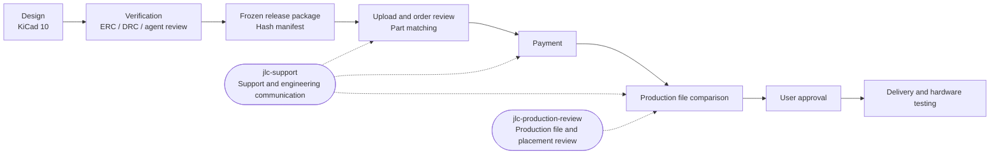

# pcb-agent-workflow

[繁體中文](README.md) | **English**

A workflow for designing PCBs in KiCad 10 with Claude Code or Codex, then having them manufactured by JLCPCB.

This workflow grew out of an actual four-layer GNSS breakout board project (u-blox MAX-M10S, 25 × 36.5 mm), from design and review through quoting, order review, support correspondence, and approval of the factory's production files. Practices that proved useful became documentation and skills; lessons from mistakes became checklist items.

**Making your first PCB?** Start with the [getting-started guide](docs/getting-started.md): it walks from installing KiCad to placing a JLCPCB order, explaining what you do, what you can ask an agent to do, and how to check the result at each step. Read the other documents as needed.

This README is available in English. The linked guides, templates, and skills are primarily in Traditional Chinese; message templates for JLCPCB are in English.

## Contents

| Path | Description |
|---|---|
| [docs/getting-started.md](docs/getting-started.md) | **Getting started**: scope of a first board, environment setup, schematics, component selection, board rules, routing, export, and ordering |
| [docs/first-board-checklist.md](docs/first-board-checklist.md) | Pre-manufacturing checklist for people and agent reviewers |
| [docs/glossary.md](docs/glossary.md) | Glossary: Gerber, BOM, CPL, DFM, tooling rails, Basic/Extended parts, and more |
| [docs/workflow/collaboration.md](docs/workflow/collaboration.md) | Collaboration between people and multiple agents: one writer, WORKLOG, handoff order, a maximum of two review rounds, and actions requiring user approval |
| [docs/workflow/kicad-tools.md](docs/workflow/kicad-tools.md) | Roles of the native KiCad CLI and KiCad MCP, common commands, and backups before PCB changes |
| [docs/workflow/release-package.md](docs/workflow/release-package.md) | Frozen release packages: contents, hash manifests, release checks, and version-folder naming |
| [docs/workflow/jlc-ordering.md](docs/workflow/jlc-ordering.md) | JLCPCB ordering: service tiers, BOM/CPL, part matching, cost control, order settings, and the post-payment process |
| [skills/jlc-support/](skills/jlc-support/SKILL.md) | Skill for communicating with JLCPCB support, engineers, and sales: message structure, six templates, a deadline calculator, companion tools, and stop conditions |
| [skills/jlc-production-review/](skills/jlc-production-review/SKILL.md) | Skill for reviewing factory production files and parts placement: align factory CAM output with the original Gerbers, compare layers, classify differences, and verify placement; includes comparison scripts and BOM/CPL checks |
| [skills/readable-schematic-layout/](skills/readable-schematic-layout/SKILL.md) | Skill for readable, debuggable schematics and layouts: built-in symbols, power symbols, actual wires, grouping by flow, and non-overlapping text; includes netlist comparison and pin-to-pad checks to verify that presentation changes preserve the circuit |
| [skills/kicad-enclosure-step/](skills/kicad-enclosure-step/SKILL.md) | Skill for exporting a KiCad board as STEP with all components for enclosure design: inventory missing models, find manufacturer models or build them from datasheet dimensions, align them, export from a temporary copy without changing the source board, check each component's placement, and document enclosure considerations |
| [.claude-plugin/marketplace.json](.claude-plugin/marketplace.json) | Shared plugin marketplace for Claude Code and Codex: one plugin per skill, plus an optional email confirmation hook |
| [plugins/jlc-send-guard/](plugins/jlc-send-guard/) | Optional Claude Code hook requiring confirmation before Gmail send-related tools run |
| [templates/](templates/) | Starter `AGENTS.md`, `CLAUDE.md`, `WORKLOG.md`, and `README.md` files, plus a KiCad project `.gitignore` |
| [scripts/](scripts/) | Release packaging and verification, a Konnect stdio caller, and this repository's privacy and skill checks; skill-specific scripts live in each skill's own `scripts/` directory |
| [examples/max-m10s-breakout-revc/](examples/max-m10s-breakout-revc/README.md) | An example design package actually submitted for manufacturing: native KiCad files, Gerbers, BOM, CPL, assembly drawings, and verification records |
| [examples/max-m10s-breakout-revc-cad/](examples/max-m10s-breakout-revc-cad/README.md) | STEP model of the same board with all components, previews, and export settings for enclosure design; an example for `kicad-enclosure-step` |

## Workflow overview



## Getting started

### New projects

Copy the four Markdown files in `templates/` to the root of your PCB project and replace the `<...>` placeholders. Copy `kicad-project.gitignore` and rename it to `.gitignore`. If your project already has a `README.md`, merge the template sections into it instead of overwriting it. At each handoff, the agent starts with `README.md` and `WORKLOG.md`.

### Installing skills

Each of the four skills is a separate plugin, so you can install only what you need. Claude Code and Codex use the same marketplace (`.claude-plugin/marketplace.json`) and the same `SKILL.md` files.

| Plugin | Purpose |
|---|---|
| `jlc-support` | Communicate with JLCPCB support, engineers, and sales; includes approval-deadline calculation |
| `jlc-production-review` | Review production files and parts placement; includes CAM comparison and BOM/CPL checks |
| `readable-schematic-layout` | Make schematics and layouts readable and easy to debug; includes netlist and pin-to-pad checks |
| `kicad-enclosure-step` | Export a board as STEP with all components for enclosure design; includes model inventory, export, individual placement verification, and model-building scripts |
| `jlc-send-guard` | Optional Claude Code hook, disabled by default; see “Email confirmation hook” below |

**Claude Code** (enter in the conversation):

```text
/plugin marketplace add John-owo/pcb-agent-workflow
/plugin install jlc-support@pcb-agent-workflow
```

Claude Code 2.1.275 and later also support a single command: `/plugin install jlc-support --marketplace John-owo/pcb-agent-workflow`. Update with `/plugin marketplace update pcb-agent-workflow`.

**Codex** (in a terminal):

```bash
codex plugin marketplace add John-owo/pcb-agent-workflow
```

```bash
codex plugin add jlc-support@pcb-agent-workflow
```

Update with `codex plugin marketplace upgrade`. Replace `jlc-support` with another name from the table to install that plugin. After installation, start a new conversation and ask the agent to “draft a message asking JLCPCB for a DFM update,” “compare the production files sent by the factory,” “make the schematic easier to read without changing the circuit,” or “export a STEP model with all components for enclosure design” to use the corresponding skill.

**Script dependencies:** The CAM comparison scripts in `jlc-production-review` require Python 3.12 and pinned packages. Run `python -m pip install -r scripts/requirements-cam.txt` from the skill directory, preferably in a virtual environment. `kicad-enclosure-step` requires KiCad 10; its `step_report.py`, `simple_model.py`, and `verify_placement.py` scripts also require [CadQuery](https://github.com/CadQuery/cadquery) (`python -m pip install cadquery`, preferably in a virtual environment). See [examples/max-m10s-breakout-revc-cad](examples/max-m10s-breakout-revc-cad/README.md) for examples and reproduction commands. The other scripts use only the Python standard library.

#### Manual installation without plugins

Copy the skill folder into your agent's skills directory. Create the destination directory first: otherwise, the copy command may place the skill's contents directly under `skills/`, where the agent will not find it.

```bash
git clone https://github.com/John-owo/pcb-agent-workflow.git
```

Claude Code (macOS / Linux / Git Bash):

```bash
mkdir -p ~/.claude/skills && cp -r pcb-agent-workflow/skills/jlc-support ~/.claude/skills/
```

Codex (the user-level skills directory documented by Codex is `~/.agents/skills`; the older `~/.codex/skills` location has not been verified):

```bash
mkdir -p ~/.agents/skills && cp -r pcb-agent-workflow/skills/jlc-support ~/.agents/skills/
```

Windows PowerShell (replace `.claude` with `.agents` for Codex):

```powershell
New-Item -ItemType Directory -Force "$HOME\.claude\skills" | Out-Null
Copy-Item -Recurse -Force pcb-agent-workflow\skills\jlc-support "$HOME\.claude\skills\"
```

After installation, check that `~/.claude/skills/jlc-support/SKILL.md` exists, or the equivalent path under `~/.agents/skills/`. Rerun the same commands to update. For use in a single project, place the skill in that project's `.claude/skills/` or `.agents/skills/` directory. Manual installation does not include the `jlc-send-guard` hook.

#### Email confirmation hook (optional, Claude Code only)

`jlc-send-guard` requires confirmation before Gmail connector tools whose names contain `send`, `reply`, or `forward` run, including in auto mode. Draft tools are unaffected. The hook is disabled by default; enable it yourself if needed:

```text
/plugin install jlc-send-guard@pcb-agent-workflow
/plugin enable jlc-send-guard@pcb-agent-workflow
```

Limitations:

- It matches tool names using the regular expression `^mcp__.*[Gg][Mm][Aa][Ii][Ll].*__.*([Ss]end|[Rr]eply|[Ff]orward)`. Renamed connectors may escape matching. Use `/mcp` to check whether your Gmail tool names are covered. Other tools with similar names may also match, resulting in an extra confirmation.
- **It cannot intercept browser actions.** The hook cannot see page URLs or button labels, so clicking Confirm or Submit through Claude in Chrome is outside its scope. Those actions depend on the skill's mandatory rules and the Chrome extension's site permissions.
- It has not been verified in Codex. Codex plugin hooks require user trust before execution, and interception of ChatGPT's Gmail connector is also unverified.
- This is an additional safeguard. It does not replace the skill's mandatory rule requiring explicit user approval in the conversation before sending.

### Companion KiCad analysis skills

For schematic analysis, BOM management, DRC review, EMC, SPICE, and related tasks, use [aklofas/kicad-happy](https://github.com/aklofas/kicad-happy) (MIT). This repository does not bundle it; follow its installation instructions. Skills used in this workflow include `kicad`, `bom`, `jlcpcb`, `lcsc`, `datasheets`, `emc`, and `spice`.

### What is docs/agents?

`docs/agents/` contains configuration for the engineering skills in [mattpocock/skills](https://github.com/mattpocock/skills), such as `triage`, `to-tickets`, and `to-spec`: where issues are stored and which triage labels to use. You can ignore it if you do not use those skills.

### Handoffs between Codex and Claude Code

When the two agents take turns working on the same task, use the handoff format in [John-owo/codex-cc-handoff](https://github.com/John-owo/codex-cc-handoff).

## Core principles

- **Only one writer per working directory at a time.** Record the owner and stopping point in WORKLOG when handing off.
- **Make a complete, recoverable backup before changing a PCB.** A hash manifest identifies files; it cannot restore them.
- **Passing ERC/DRC does not establish electrical correctness, factory acceptance, or working hardware.**
- **Payment, order submission, sending messages, and approving factory confirmation materials each require user approval.** The agent prepares drafts and materials up to that point. The only exception is progress inquiries and purely technical clarification, which the user may authorize in advance with a defined scope and time limit.
- **Keep frozen release packages separate from ongoing progress records.** Do not modify the version handed to the factory; track order progress elsewhere.

## Limitations

- The example board passed ERC/DRC and agent review and was manufactured and SMT-assembled by JLCPCB. Both assembled boards passed hardware testing: power-up, UART, passive-antenna 3D fix, 1 Hz PPS and I2C. With injected A-GNSS aiding data, time to first fix was roughly one-eighth of a cold start. The example is the release package submitted with the order; subsequent factory CAM adjustments are not included. See [examples/max-m10s-breakout-revc-tests](examples/max-m10s-breakout-revc-tests/README.md) for hardware-test procedures and results.
- JLCPCB deadlines, prices, and parts-library availability reflect observations from September 2026. Check the current website and correspondence for your order.
- The workflow primarily targets Windows, KiCad 10, and JLCPCB. The communication principles may help with other manufacturers, but their website processes differ.

## Supported environment

This workflow has been verified only in the following environment:

| Item | Support |
|---|---|
| Operating system | Windows |
| EDA | KiCad 10 |
| Agents | Claude Code and Codex; both are supported. Plugin installation tested with Claude Code 2.1.299 and Codex CLI 0.163 |
| Manufacturer | JLCPCB |
| Delivery destination | Taiwan, via SF Express |

`SKILL.md` files and scripts are the shared baseline for both agents. Enhancements verified only in Claude Code are labeled separately; currently, that is only the `jlc-send-guard` hook. The skills remain complete without it, and their mandatory rules still apply.

Other environments (macOS, Linux, other KiCad versions, or manufacturers such as PCBWay) may work but have not been verified. Issues specific to those environments are labeled `wontfix` with the response “may work, unverified.” The communication principles can be used regardless of manufacturer.

## License

MIT; see [LICENSE](LICENSE). See [NOTICE](NOTICE) for the sources of footprints and symbols adapted from the official KiCad libraries and other third-party content. Manufacturer datasheets are not bundled; the example README links to the manufacturers' originals.
