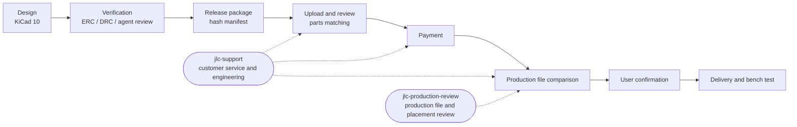

# pcb-agent-workflow

A workflow for designing PCBs in KiCad 10 with Claude Code or Codex as an assistant, and having JLCPCB manufacture them.

This workflow comes from real experience with a 4-layer GNSS test board (u-blox MAX-M10S, 25 × 36.5 mm), from design, review, quoting, and submission for review, through customer service back-and-forth, to confirming the production file. Practices that proved useful repeatedly became docs and skills; pitfalls we hit became checklist items.

**First PCB?** Start with [Getting started](docs/getting-started.md): from installing KiCad to ordering at JLC, each step says what you do, what you can ask the agent to do, and how to check it's right. Read the other docs later.

## Contents

| Path | Contents |
|---|---|
| [docs/getting-started.md](docs/getting-started.md) | **Getting started**: first-board scope, environment, schematic, part selection, board rules, routing, export, ordering |
| [docs/first-board-checklist.md](docs/first-board-checklist.md) | Pre-fab checklist, for people to read and for agent review |
| [docs/glossary.md](docs/glossary.md) | Glossary: Gerber, BOM, CPL, DFM, rails, Basic/Extended parts, etc. |
| [docs/workflow/collaboration.md](docs/workflow/collaboration.md) | People working with multiple agents: single writer, WORKLOG, takeover order, at most two review rounds, which actions need user consent |
| [docs/workflow/kicad-tools.md](docs/workflow/kicad-tools.md) | Division of labor between the native KiCad CLI and KiCad MCP, common commands, securing backups before modifying the PCB |
| [docs/workflow/release-package.md](docs/workflow/release-package.md) | Release package: contents, hash manifest, release-checks, version folder naming |
| [docs/workflow/jlc-ordering.md](docs/workflow/jlc-ordering.md) | JLC ordering: service levels, BOM/CPL, parts matching review, cutting cost, order settings, post-payment process |
| [skills/jlc-support/](skills/jlc-support/SKILL.md) | Skill for communicating with JLC customer service, engineering, and sales contacts: message structure, six templates, deadline calculation script, tool pairing, stop conditions |
| [skills/jlc-production-review/](skills/jlc-production-review/SKILL.md) | Skill for reviewing the factory production file and parts placement confirmation: aligns the factory CAM file back to the original Gerbers and compares layer by layer, classifies differences, checks placement; includes comparison scripts and BOM/CPL checks |
| [skills/readable-schematic-layout/](skills/readable-schematic-layout/SKILL.md) | Skill for drawing schematics and layouts that are easy for humans to read and debug: built-in symbols, power symbols, real wires, regions by signal flow, no overlapping text; includes netlist comparison and pin-to-pad check scripts that prove only the drawing changed, not the circuit |
| [skills/kicad-enclosure-step/](skills/kicad-enclosure-step/SKILL.md) | Exports a KiCad board as a STEP with all parts for enclosure design: inventories parts missing models, finds vendor models or draws them from datasheets, aligns them, exports from a temporary copy (board file untouched), automatically checks each part's position, and finally writes enclosure notes |
| [.claude-plugin/marketplace.json](.claude-plugin/marketplace.json) | Plugin marketplace shared by Claude Code and Codex: one plugin per skill, plus the optional send confirmation hook |
| [plugins/jlc-send-guard/](plugins/jlc-send-guard/) | Optional Claude Code hook: forces a confirmation before Gmail send-type tools run |
| [templates/](templates/) | `AGENTS.md`, `CLAUDE.md`, `WORKLOG.md`, `README.md` for new projects, plus a `.gitignore` for KiCad projects |
| [scripts/](scripts/) | Release package bundling and verification, Konnect stdio caller, this repo's privacy scan and skill check (skill-specific scripts live in each skill's own `scripts/`) |
| [examples/max-m10s-breakout-revc/](examples/max-m10s-breakout-revc/README.md) | Example design package that was actually ordered: native KiCad files, Gerbers, BOM, CPL, assembly drawings, verification records |
| [examples/max-m10s-breakout-revc-cad/](examples/max-m10s-breakout-revc-cad/README.md) | STEP (with all parts) for enclosure design of the board above, preview images, and export settings; the kicad-enclosure-step example |

## Workflow overview



## Getting started

### New project

Copy the four Markdown files in `templates/` to the PCB project root and replace `<...>` with your own content; copy `kicad-project.gitignore` and rename it to `.gitignore`. If the project already has a `README.md`, don't overwrite it; merge the template's sections into it. From then on, each time an agent takes over, it starts by reading `README.md` and `WORKLOG.md`.

### Installing skills

Each of the four skills is its own plugin, so you can install only what you need. Claude Code and Codex read the same marketplace (`.claude-plugin/marketplace.json`) and the same `SKILL.md`.

| plugin | Purpose |
|---|---|
| `jlc-support` | Communicating with JLC customer service, engineering, and sales contacts; includes confirmation item deadline calculation |
| `jlc-production-review` | Reviewing production files and parts placement confirmation; includes CAM comparison and BOM/CPL check scripts |
| `readable-schematic-layout` | Making schematics and layouts easy to read and debug; includes netlist and pin-to-pad checks |
| `kicad-enclosure-step` | Exports the board as a STEP with all parts for enclosure design; includes inventory, export, per-part position check, and self-drawn model scripts |
| `jlc-send-guard` | Optional Claude Code hook, see "Send confirmation hook" below; disabled by default |

**Claude Code** (type in the conversation):

```text
/plugin marketplace add John-owo/pcb-agent-workflow
/plugin install jlc-support@pcb-agent-workflow
```

Claude Code 2.1.275 and later can also do it in one step: `/plugin install jlc-support --marketplace John-owo/pcb-agent-workflow`. Update with `/plugin marketplace update pcb-agent-workflow`.

**Codex** (in a terminal):

```bash
codex plugin marketplace add John-owo/pcb-agent-workflow
```

```bash
codex plugin add jlc-support@pcb-agent-workflow
```

Update with `codex plugin marketplace upgrade`. Replace `jlc-support` with another name from the table to install other plugins. After installing, start a new conversation and tell the agent things like "write JLC an email chasing the DFM", "compare the production file the factory sent", "redraw the schematic so it's easy to read, without changing the circuit", or "I'm designing an enclosure, give me a STEP with all parts", and the matching skill will apply.

**Script dependencies**: the CAM comparison scripts in `jlc-production-review` need Python 3.12 and pinned package versions; in the skill folder run `python -m pip install -r scripts/requirements-cam.txt` (a venv is recommended). `kicad-enclosure-step` needs KiCad 10; its `step_report.py`, `simple_model.py`, and `verify_placement.py` also need [CadQuery](https://github.com/CadQuery/cadquery) (`python -m pip install cadquery`, a venv is recommended); see [examples/max-m10s-breakout-revc-cad](examples/max-m10s-breakout-revc-cad/README.md) for the example and reproduction commands. Other scripts use only the Python standard library.

#### Manual install (without plugins)

Copy the skill folder into the agent's skills directory. Create the directory first, then copy; if the directory doesn't exist, the copy command spreads the skill's contents directly under `skills/` and the agent can't find it.

```bash
git clone https://github.com/John-owo/pcb-agent-workflow.git
```

Claude Code (macOS/Linux/Git Bash):

```bash
mkdir -p ~/.claude/skills && cp -r pcb-agent-workflow/skills/jlc-support ~/.claude/skills/
```

Codex (the Codex docs give `~/.agents/skills` as the user skill directory; the old `~/.codex/skills` is unverified):

```bash
mkdir -p ~/.agents/skills && cp -r pcb-agent-workflow/skills/jlc-support ~/.agents/skills/
```

Windows PowerShell (for Codex, replace `.claude` with `.agents`):

```powershell
New-Item -ItemType Directory -Force "$HOME\.claude\skills" | Out-Null
Copy-Item -Recurse -Force pcb-agent-workflow\skills\jlc-support "$HOME\.claude\skills\"
```

After installing, `~/.claude/skills/jlc-support/SKILL.md` (or the same path under `~/.agents/skills/`) should exist. To update, rerun the same commands. To use a skill in a single project only, put it in that project's `.claude/skills/` or `.agents/skills/`. Manual install does not include the `jlc-send-guard` hook.

#### Send confirmation hook (optional, Claude Code only)

`jlc-send-guard` forces a confirmation prompt before the Gmail connector's send-type tools (names containing `send`, `reply`, `forward`) run, even in auto mode. Draft tools are not affected. It is disabled by default; enable it yourself if you want it:

```text
/plugin install jlc-send-guard@pcb-agent-workflow
/plugin enable jlc-send-guard@pcb-agent-workflow
```

Limitations:

- It matches tool names with a regular expression: `^mcp__.*[Gg][Mm][Aa][Ii][Ll].*__.*([Ss]end|[Rr]eply|[Ff]orward)`. If the connector is renamed it may miss tools; check in `/mcp` whether your Gmail tool names are covered. Other tools with similar names may also be caught, which only costs one extra confirmation.
- **It cannot block actions in the browser.** The hook can't see page URLs or button text, so Claude in Chrome clicking Confirm or Submit is outside its scope; that part relies only on the skill's hard rules and the Chrome extension's site permissions.
- Not verified on Codex. Codex plugin hooks only run after the user trusts them, and it's uncertain whether ChatGPT's Gmail connector can be intercepted.
- It is an extra line of defense and does not replace the skill's hard rules: sending still requires the user's explicit consent in the conversation.

### Companion KiCad analysis skills

Skills for schematic analysis, BOM, DRC review, EMC, SPICE, etc. come from [aklofas/kicad-happy](https://github.com/aklofas/kicad-happy) (MIT). This repo does not include a copy; install it following that repo's instructions. The ones this workflow actually uses are `kicad`, `bom`, `jlcpcb`, `lcsc`, `datasheets`, `emc`, `spice`.

### What docs/agents is

`docs/agents/` holds settings read by the engineering skills from [mattpocock/skills](https://github.com/mattpocock/skills) (`triage`, `to-tickets`, `to-spec`, etc.): where issues are tracked and what the triage labels are called. If you haven't installed those skills, you don't need it and can ignore it.

### Handoff between Codex and Claude Code

When two agents take turns on the same task, see [John-owo/codex-cc-handoff](https://github.com/John-owo/codex-cc-handoff) for the handoff format.

## Core principles

- **One writer per working directory at a time.** On handoff, record the owner and stopping point in the WORKLOG.
- **Secure a complete backup before modifying the PCB.** A hash manifest only identifies files; it can't restore them.
- **Passing ERC/DRC does not mean electrically correct, accepted by the fab, or a working real board.**
- **Payment, order submission, sending email, and confirming production files each wait for the user's consent every time.** The agent stops at drafting and preparing. The only exception is status chases and pure technical clarifications: the user can pre-authorize them by stating a scope and deadline.
- **Keep the release package separate from changing progress.** The version handed to the factory is not changed again; order progress is recorded separately.

## Limitations

- The example board passed ERC/DRC and agent review and was actually ordered, but has not yet been tested as a real board. The example is the release package as submitted; fine adjustments the factory made in CAM afterward are not in it. See [examples/max-m10s-breakout-revc-tests](examples/max-m10s-breakout-revc-tests/README.md) for the bench test procedure and results.
- JLC deadlines, prices, and parts library status are as observed 2026-09; the current website and emails take precedence.
- The workflow targets Windows, KiCad 10, and JLCPCB. Other fabs can use the communication principles, but their website flows differ.

## Support scope

This workflow has been verified only in the environment below:

| Item | Supported |
|---|---|
| Operating system | Windows |
| EDA | KiCad 10 |
| agent | Claude Code, Codex (both must work). Plugin install tested on Claude Code 2.1.299 and Codex CLI 0.163 |
| Fab | JLCPCB |
| Shipping destination | Taiwan (SF Express) |

SKILL.md and the scripts are the shared baseline for both agents. Enhancements verified only on Claude Code are marked separately: currently only the `jlc-send-guard` hook. Without it, the skills are just as complete and the hard rules still apply.

Other environments (macOS, Linux, other KiCad versions, other fabs such as PCBWay) may work but are unverified. Such issues are labeled `wontfix` with the reply "may work, unverified"; the communication principles are not fab-specific and can be used as is.

## License

MIT, see [LICENSE](LICENSE). For footprints and symbols in the example adapted from the official KiCad libraries, and the sources of other third-party content, see [NOTICE](NOTICE). Vendor datasheets are not included; the example README lists vendor links.
