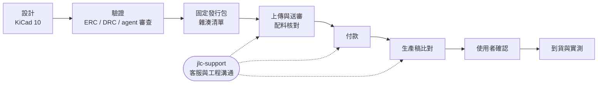

# pcb-agent-workflow

用 Claude Code 或 Codex 當助手，在 KiCad 10 設計 PCB、交 JLCPCB 製造的一套工作流程。

這套流程來自一塊 4 層 GNSS 測試板（u-blox MAX-M10S，25 × 36.5 mm）從設計、審查、報價、送審、客服往返到確認生產稿的實際經驗。重複有用的做法寫成文件和 skill；踩過的雷寫成檢查項目。

## 內容

| 路徑 | 內容 |
|---|---|
| [docs/workflow/collaboration.md](docs/workflow/collaboration.md) | 人與多個 agent 協作：單一寫入者、WORKLOG、接手順序、審查最多兩輪、哪些動作要使用者同意 |
| [docs/workflow/kicad-tools.md](docs/workflow/kicad-tools.md) | KiCad 原生 CLI 與 KiCad MCP 的分工、常用命令、修改 PCB 前的保全 |
| [docs/workflow/release-package.md](docs/workflow/release-package.md) | 固定發行包：內容、雜湊清單、release-checks、版本資料夾命名 |
| [docs/workflow/jlc-ordering.md](docs/workflow/jlc-ordering.md) | JLC 下單：服務等級、BOM／CPL、配料核對、壓成本、送單設定、付款後流程 |
| [docs/workflow/production-file-review.md](docs/workflow/production-file-review.md) | 收到工廠生產稿後，怎麼跟原始 Gerber 比對、怎麼判讀差異 |
| [skills/jlc-support/](skills/jlc-support/SKILL.md) | 跟 JLC 客服、工程、業務窗口溝通的 skill：寫信結構、六種範本、期限、停止條件 |
| [templates/](templates/) | 新專案用的 `AGENTS.md`、`CLAUDE.md`、`WORKLOG.md`、`README.md` |
| [scripts/](scripts/) | 發行包打包驗證、Konnect stdio 呼叫器、生產稿差異比對 |
| [examples/max-m10s-breakout-revc/](examples/max-m10s-breakout-revc/README.md) | 實際下單過的範例設計包：KiCad 原生檔、Gerber、BOM、CPL、裝配圖、驗證紀錄 |

## 流程總覽



## 開始使用

### 新專案

把 `templates/` 裡的四個檔案複製到 PCB 專案根目錄，把 `<...>` 換成自己的內容。專案已經有 `README.md` 的話，不要直接覆蓋，把範本的段落合併進去。之後每次接手，agent 會從 `README.md` 和 `WORKLOG.md` 讀起。

### 安裝 jlc-support skill

Claude Code 與 Codex 共用同一份 `SKILL.md`：

```bash
git clone https://github.com/John-owo/pcb-agent-workflow.git
```

Claude Code（macOS／Linux／Git Bash）：

```bash
cp -r pcb-agent-workflow/skills/jlc-support ~/.claude/skills/
```

Codex：

```bash
cp -r pcb-agent-workflow/skills/jlc-support ~/.codex/skills/
```

Windows PowerShell：

```powershell
Copy-Item -Recurse pcb-agent-workflow\skills\jlc-support "$HOME\.claude\skills\"
Copy-Item -Recurse pcb-agent-workflow\skills\jlc-support "$HOME\.codex\skills\"
```

只想在單一專案使用，就放到該專案的 `.claude/skills/`。安裝後跟 agent 說「幫我寫信催 JLC 的 DFM」或「訂單被取消了，幫我追問」，就會套用這個 skill。

### 搭配的 KiCad 分析 skill

原理圖分析、BOM、DRC 審查、EMC、SPICE 等 skill 使用 [aklofas/kicad-happy](https://github.com/aklofas/kicad-happy)（MIT）。本 repo 不附副本，請依該 repo 的說明安裝。這套流程實際用到的有 `kicad`、`bom`、`jlcpcb`、`lcsc`、`datasheets`、`emc`、`spice`。

### docs/agents 是什麼

`docs/agents/` 是給 [mattpocock/skills](https://github.com/mattpocock/skills) 那套工程類 skill（`triage`、`to-tickets`、`to-spec` 等）讀的設定：issue 記在哪裡、triage 標籤叫什麼。沒安裝那套 skill 就用不到，可以忽略。

### Codex 與 Claude Code 交接

兩個 agent 輪流接手同一個任務時，交接格式見 [John-owo/codex-cc-handoff](https://github.com/John-owo/codex-cc-handoff)。

## 核心原則

- **一個工作目錄同時只有一位寫入者。** 換手時在 WORKLOG 記錄 owner 與停止點。
- **改 PCB 前先保全完整備份。** 雜湊清單只能識別檔案，不能還原。
- **ERC／DRC 通過，不等於電氣正確、板廠接受或實板能動。**
- **付款、送單、寄信、確認生產稿，每一次都等使用者同意。** agent 做到起草和準備為止。唯一的例外是催辦與純技術澄清：使用者可以說明範圍和期限，事先授權。
- **固定發行包與動態進度分開。** 交給工廠的版本不再改；訂單進度另外記。

## 限制

- 範例板完成了 ERC／DRC 與 agent 審查，也實際送單了，但還沒有實板測試。範例是送單時的發行包；工廠 CAM 之後做的微調不在裡面。詳見範例的 README。
- JLC 的期限、價格、料庫狀態是 2026-09 的觀察，以當下的網站和信件為準。
- 流程以 Windows、KiCad 10、JLCPCB 為主要環境。其他板廠可以參考溝通原則，但網站流程不同。

## 授權

MIT，見 [LICENSE](LICENSE)。範例中改自 KiCad 官方元件庫的 footprint 與 symbol，以及其他第三方內容的來源，見 [NOTICE](NOTICE)。原廠 datasheet 不隨附，範例 README 列有原廠連結。
