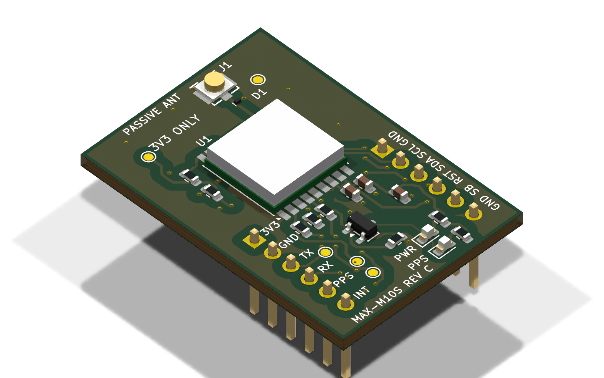

# MAX-M10S Breakout Rev C: 3D Files for Enclosure Design

Source design: `MAX-M10S-Passive.kicad_pcb` from [../max-m10s-breakout-revc/](../max-m10s-breakout-revc/README.md) (release package, unmodified). Generated with the [kicad-enclosure-step](../../skills/kicad-enclosure-step/SKILL.md) skill, and also serves as that skill's example. These files are for enclosure design only, not for manufacturing.



## Files

| File | Contents |
|---|---|
| `MAX-M10S-RevC.step` | Full board plus 19 parts. The 5 test pads have no height and get no model |
| `preview-top.png`, `preview-bottom.png` | Top and bottom renders |
| `enclosure-step.json` | Export config: which model each footprint uses |
| `models/*.json` → `models/*.step` | Dimension specs (with sources) for the three self-drawn models, and the generated STEP files |

To regenerate (run from the repo root; requires KiCad 10 and CadQuery):

```bash
python skills/kicad-enclosure-step/scripts/simple_model.py examples/max-m10s-breakout-revc-cad/models/*.json
python skills/kicad-enclosure-step/scripts/export_step.py examples/max-m10s-breakout-revc-cad/enclosure-step.json --render examples/max-m10s-breakout-revc-cad/preview
python skills/kicad-enclosure-step/scripts/verify_placement.py examples/max-m10s-breakout-revc-cad/enclosure-step.json
```

## Coordinates

- Units are mm. Origin at the board's bottom-left corner, on the board's bottom face; +X right, +Y up, +Z toward the component side.
- Board is 25.0 × 36.5 × 1.6 mm, occupying x 0–25, y 0–36.5, z 0–1.6. Antenna connector J1 is on the top edge (the high-y side).
- Overall bounding box: x 0–25, y 0–36.5, z −8.63 to +4.10.

## Enclosure considerations

| Item | STEP position | Notes |
|---|---|---|
| Highest point on top | U1 MAX-M10S, x 7.45–17.55, y 17.05–26.75 | Top at z 4.10 (2.5 mm above the board surface, datasheet typical; max 2.7) |
| Antenna connector J1 (I-PEX MHF I) | x 14.3–17.3, y 32.4–35.0 | Receptacle is 1.25 mm tall. With a 20670-series plug mated, max height is 2.5 mm (z about 4.1); the cable exits from the side of the plug, so the enclosure needs a cable exit. The passive antenna and cable are not in the STEP |
| Power/PPS LEDs (D2, D3) | x 15.2–16.8, y 3.9–4.7 (D2) and 1.6–2.4 (D3) | 0603, 1.1 mm tall. To see the LEDs, add a window or light pipe here |
| Headers J2, J3 | J2 x 2.3–4.9, J3 x 20.1–22.7, y 2.0–17.2 | Inserted from the board bottom: plastic housing on the bottom side, pins extending down to z −8.63; solder joints protrude about 1.3 mm on the top side (to z 2.92). Rows are 17.78 mm center-to-center and plug straight into a breadboard |
| Bottom side | Headers only | No other parts |
| Mounting holes | None | The enclosure must hold the board by the headers or by clamping the board edges |

`verify_placement.py` height table (2026-10-22): all 19 parts pass.

## Model sources

| Footprint | Designator | Source |
|---|---|---|
| C_0603, R_0603, LED_0603, SOT23, Header_1x06 | C1–C3, R1–R8, D2, D3, Q1, J2, J3 | Official KiCad 10 3D library, referenced via `${KICAD10_3DMODEL_DIR}`. These footprints are renamed copies of official library footprints with unchanged pads (see the repo NOTICE), so all offsets are 0 |
| MAX_M10S | U1 | Self-drawn: u-blox MAX-M10S data sheet (UBX-20035208 R08) Table 21, 9.7 × 10.1 × 2.5 mm (typical) |
| MHF_I | J1 | Self-drawn: I-PEX 20279-001E-03 drawing, body 2.6 × 3.0 mm, 1.25 mm tall |
| PESD3V3C1BSF | D1 | Self-drawn: Nexperia DSN0603-2 (SOD962-2), 0.6 × 0.3 × 0.3 mm |

Self-drawn models show only the outer envelope. For critical enclosure cutout and snap-fit dimensions, rely on measurements of the physical parts.

## License

- Self-drawn models (`models/`) and this page: MIT, per the repo.
- `MAX-M10S-RevC.step` contains geometry from the official KiCad 3D library; under the KiCad library exception, output that uses these models may be used freely. See the repo NOTICE.
